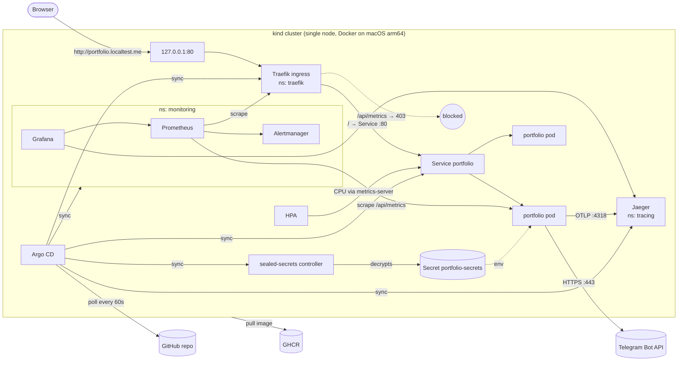

# Architecture

## Components



| Component | Role | Namespace |
|---|---|---|
| portfolio (Next.js) | Static pages + `/api/contact`, health, version and metrics routes | `portfolio` |
| Traefik | Ingress controller; edge metrics (request rate, latency, status) and JSON access logs | `traefik` |
| Argo CD | GitOps controller; reconciles the cluster to `deploy/` in Git | `argocd` |
| sealed-secrets | Decrypts SealedSecrets committed to Git into Secrets | `kube-system` |
| metrics-server | CPU/memory for the HPA | `kube-system` |
| kube-prometheus-stack | Prometheus, Alertmanager, Grafana, kube-state-metrics, node-exporter | `monitoring` |
| Jaeger | Trace storage + UI (OTLP receiver) | `tracing` |

## Request path

1. Browser → `portfolio.localtest.me` resolves to `127.0.0.1`. kind maps host port 80 to
   NodePort 30080 on the node container.
2. Traefik matches the Ingress host. `/api/metrics` is matched by a more specific route
   with an IP allow-list middleware (loopback only), so outside clients get **403**.
   Everything else goes to Service `portfolio:80`.
3. The Service load-balances across **Ready** pods only, as gated by the readiness probe `/api/ready`.
4. Pages are pre-rendered static content served by the Next.js standalone server.
   `POST /api/contact` is handled as follows:
   - validates the input (zod)
   - applies the per-IP rate limit (taken from Traefik's `X-Forwarded-For`)
   - calls the Telegram Bot API (5s timeout, traced as span `telegram.sendMessage`)
   - responds 200, 400, 429 or **502** (Telegram failed)

## Delivery path (commit → running pod)

```mermaid
sequenceDiagram
  participant Dev
  participant GH as GitHub
  participant CI as Actions (release.yml)
  participant GHCR
  participant Argo as Argo CD (kind)
  participant K8s as Deployment
  Dev->>GH: git push
  GH->>CI: push event
  CI->>CI: ci.yml: lint, typecheck, test, build, audit, gitleaks, trivy config, helm lint, kubeconform
  CI->>GHCR: build amd64 + arm64 natively, push by digest, create sha-<commit> manifest list
  CI->>CI: trivy image scan, helm --atomic on ephemeral kind, smoke test (/api/version == commit)
  CI->>GH: commit image.tag + image.digest to deploy/envs/local/values.yaml
  Argo->>GH: poll (60s), detects new revision
  Argo->>K8s: helm render + apply (rolling update, maxUnavailable 0)
  K8s->>K8s: new pod: startup → readiness → receives traffic; old pod: preStop 5s → SIGTERM
```

Traceability chain: **commit SHA** → **Actions run** (linked in the deploy commit message) →
**image `sha-<commit>@sha256:…`** (OCI `revision` label, SBOM and provenance attached) →
**deploy commit** in Git → **Argo CD sync revision** → pod label `app.kubernetes.io/version` →
`GET /api/version` and the `app_build_info` metric.

## Failure boundaries

| Failure | Blast radius | Behaviour |
|---|---|---|
| Telegram API down or slow | Contact form only | Times out after 5s and returns 502. Pages stay up. Readiness is **not** tied to Telegram, so pods stay in rotation. `contact_submissions_total{outcome="delivery_failed"}` triggers the burn-rate alert. |
| Bad release (crash or failing readiness) | None for users | maxUnavailable 0 keeps old pods serving. The new pod never becomes Ready, Argo CD reports *Degraded* and `PortfolioReplicasUnavailable` fires. Fix: `git revert`. |
| Pod crash or OOM | One replica | Liveness/restart. The second replica and the PDB keep the service available. |
| Node or Docker restart | Entire cluster (single node) | A known limitation of local kind. Argo CD re-syncs from Git when the cluster comes back. |
| Argo CD down | No new deploys | Running workloads are unaffected. Drift isn't corrected until it's back. |
| GHCR unreachable | New pods can't pull | Existing pods keep running (`IfNotPresent`). |
| Prometheus/Grafana down | Visibility only | The app is unaffected. `PortfolioMetricsDown` covers lost scrapes. |

## Configuration layout

```
deploy/
  helm/portfolio/          chart: defaults shared by all environments (values.yaml)
  envs/local/values.yaml   environment overrides; image tag/digest written by CI
  argocd/bootstrap/        Argo CD install values + root app (only things applied by hand)
  argocd/apps/             app-of-apps chart: one Application per component, pinned chart versions
  platform/                monitoring values, Jaeger manifests, platform SealedSecrets
  kind/cluster.yaml        local cluster definition
```

A new environment means adding `deploy/envs/<env>/values.yaml` plus an Application.
The chart itself isn't copied, so environments can't drift apart.
